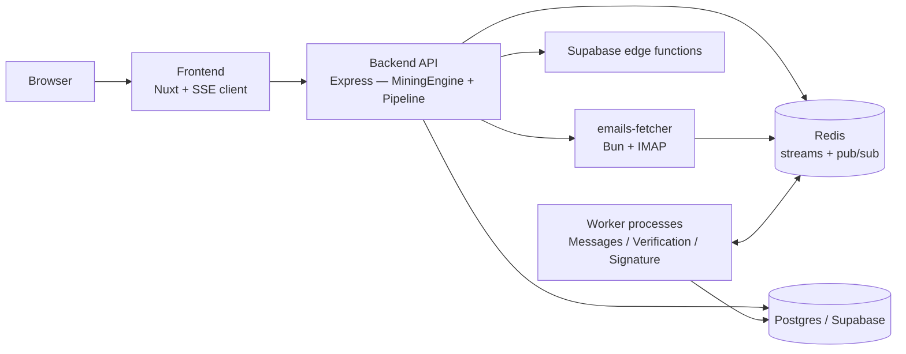

```mermaid
sequenceDiagram
  participant Br as browser
  participant API as API
  participant ME as MiningEngine
  participant P as Pipeline
  participant T as Task
  participant R as Redis
  participant MC as MessagesConsumer
  participant SSE as RealtimeSSE

  Note over P,R: 1. Register — control plane
  API->>ME: submit(pipeline)
  ME->>R: SUBSCRIBE miningId
  ME->>P: start()
  P->>P: createConsumerGroups()<br/>xgroup CREATE ... $
  P->>T: start(tasksResolver, redisPublisher)<br/>for each task
  T->>R: PUBLISH stream-management<br/>REGISTER {role, streams}
  R-->>MC: message on stream-management
  MC->>MC: role !== "extract" ? return
  MC->>MC: activeStreams.set(input)<br/>new RedisStreamProducer(output)

  Note over MC,R: 2. Consume and report — data + progress planes
  MC->>R: XREADGROUP GROUP ... NOACK<br/>STREAMS messages_stream-&#60;miningId&#62; &#62;
  R-->>MC: batch of stream entries
  MC->>R: PUBLISH miningId<br/>ProgressMessage {progressType, count}
  R-->>ME: message on miningId
  ME->>P: onMessage(json)
  P->>T: onMessage(msg) on every task
  P->>P: propagateProgress()<br/>checkCompletion()
  P->>SSE: sendSSE(value, "&#60;progressType&#62;-&#60;miningId&#62;")
  SSE-->>Br: SSE event

  Note over Br,MC: 3. Cancel
  Br->>API: POST /api/imap/mine/:type/:userId/:id
  API->>ME: terminate(miningId, processIds)
  ME->>P: cancel(processIds)
  P->>T: stop(true, ...)
  T->>R: PUBLISH stream-management<br/>DELETE {role, streams}
  R-->>MC: message on stream-management
  MC->>MC: activeStreams.delete(input)
```

# Architecture

Leadminer mines contacts from email mailboxes: it fetches messages from IMAP or a file, extracts people and organizations, optionally verifies addresses, and optionally extracts signatures. This page is for backend contributors — the processes, the stores, and the path a mining request takes. Email and SMS campaigns are out of scope; they live in `supabase/functions/` and are not documented yet. Repository layout is in [AGENTS.md](../AGENTS.md).

## Ports and processes

| Process                   | Port                     | What it does                                                                           |
| ------------------------- | ------------------------ | -------------------------------------------------------------------------------------- |
| Backend API               | `8081`                   | Express API: auth, creates pipelines, serves SSE progress, proxies source config.      |
| Contact-extraction worker | —                        | Consumes `messages_stream-<miningId>`, extracts contacts, writes Postgres.             |
| Email-verification worker | —                        | Consumes `emails_stream-<miningId>`, verifies deliverability, updates contact status.  |
| Signature worker          | —                        | Consumes the signature stream, extracts signatures, writes `private.signatures`.       |
| Emails fetcher            | `8084`                   | Standalone Bun service. Owns IMAP connections and streams fetched messages into Redis. |
| Frontend                  | `8082` (dev and compose) | Nuxt app: starts mining, opens the progress SSE stream, renders contacts.              |
| Redis                     | `6379`                   | Streams for work; pub/sub for progress and task commands.                              |
| Postgres / Supabase       | `54322` DB, `54321` API  | Stores users, sources, messages, contacts, task rows, and signatures.                  |

How each process is started, including the two dev mocks on `8083` and `8085`, is in [local-development.md](local-development.md).

## How the pieces talk

**System context.** The API process owns the orchestrator; the three workers are separate processes that reach it only through Redis.

What to take from it: no worker calls the API. Everything crossing that boundary is a Redis stream or pub/sub message.

**A mining run.** `MiningEngine.submit` registers the run, workers consume and report, and `terminate` walks the same path in reverse.

What to take from it: three planes share one Redis — commands on `stream-management`, data on per-run streams, progress on the run's `miningId` channel. The step-by-step contract, including cancellation, is owned by [mining-pipeline.md](mining-pipeline.md#task-lifecycle).

**Every Redis channel a mining run touches.**

| Channel / stream                     | Mechanism                     | Who writes                                | Who reads                                   | Payload                                                                                            |
| ------------------------------------ | ----------------------------- | ----------------------------------------- | ------------------------------------------- | -------------------------------------------------------------------------------------------------- |
| `REDIS_PUBSUB_COMMUNICATION_CHANNEL` | Pub/sub (`stream-management`) | `Task.start` / `Task.stop`                | Every worker subscriber, filtered by `role` | `StreamCommand`: `{ miningId, role, command: "REGISTER" \| "DELETE", streams: { input, output } }` |
| `messages_stream-<miningId>`         | Stream + consumer group       | `emails-fetcher` (started by `FetchTask`) | `MessagesConsumer` (`ExtractTask`)          | `EmailMessageData`                                                                                 |
| `emails_stream-<miningId>`           | Stream + consumer group       | `MessagesConsumer` output producer        | `EmailsVerificationConsumer` (`CleanTask`)  | `EmailVerificationData`                                                                            |
| `REDIS_SIGNATURE_STREAM_NAME`        | Stream + consumer group       | `emails-fetcher` when body fetch is on    | `EmailSignatureConsumer` (`SignatureTask`)  | `EmailData`                                                                                        |
| `miningId`                           | Pub/sub (one channel per run) | Workers and the fetcher                   | `MiningEngine`                              | `ProgressMessage`: `{ miningId, progressType, count, isCompleted?, isCanceled? }`                  |

## Authentication at a glance

The frontend signs in with Supabase Auth and attaches the session token to API calls as the `x-sb-jwt` header (`frontend/src/plugins/api.ts`). The backend reads that header through `SupabaseAuthResolver` and resolves the user with Supabase (`backend/src/services/auth/SupabaseAuthResolver.ts`). Workers trust the `userId` carried in the stream payload; they do not re-authenticate each message.

## The three stores

**Postgres.** All durable product data lives in the `private` schema. Start with these seven tables: `profiles`, `mining_sources`, `tasks`, `notifications`, `messages`, `persons`, `pointsofcontact`. The schema also holds `organizations`, `refinedpersons`, `tags`, `email_status`, `signatures`, and `engagement`.

See `supabase/migrations/20241205095428_migrate_to_private_schema.sql` for the core schema and `supabase/migrations/20251107141413_add-signature-table.sql` for signatures. Campaign tables exist in this schema and are not documented here. The backend reaches Postgres two ways: a `pg` pool for contacts and sources (`backend/src/db/pg/index.ts`), and the Supabase client for tasks and edge functions (`backend/src/db/supabase/tasks.ts`).

**Redis.** Redis carries two kinds of traffic: streams for work items (durable, batched, shared by worker replicas through consumer groups) and pub/sub for progress and task commands (fire-and-forget; losing a message costs a progress tick, not data). The keys, defaults, and lifetimes are in [mining-pipeline.md](mining-pipeline.md#the-redis-contract).

**File storage.** PST imports are uploaded to the Supabase Storage bucket `pst` (`frontend/src/components/mining/stepper-panels/source/ImportPstDialog.vue`) and downloaded by the fetcher before processing (`micro-services/emails-fetcher/src/services/pst/PSTEmailsFetcher.ts`). IMAP messages and parsed contacts do not use object storage.

## The mining request path

The browser calls `POST /api/imap/mine/email/:userId` (or `/file`, `/pst`) from the mining screen (`frontend/src/stores/leadminer.ts`). `backend/src/controllers/mining.controller.ts` builds a `Pipeline` with `createImapMining` and passes it to `MiningEngine.submit`. Progress comes back over `GET /api/imap/mine/:type/:id/progress/`, which `Pipeline` feeds through SSE (`frontend/src/utils/sse.ts`). For what happens between submit and the first contact, read [mining-pipeline.md](mining-pipeline.md#task-lifecycle).

Run the stack with [local-development.md](local-development.md). Both the backend and the fetcher validate their environment with Zod at boot (`backend/src/config/schema.ts`, `micro-services/emails-fetcher/src/config/schema.ts`); a missing key stops the process instead of failing later.
