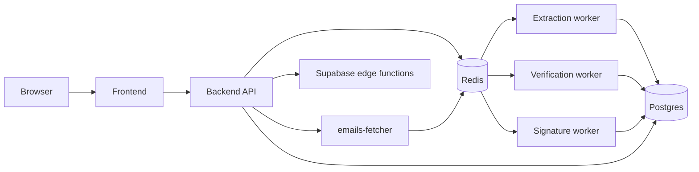

# Architecture

Leadminer mines contacts from email mailboxes. It fetches messages from IMAP or a file, extracts people and organizations, optionally verifies email addresses, and optionally extracts signatures. This page maps the processes, the stores, and the path a mining request takes.

## Repository layout

| Path                            | What lives there                                                                |
| ------------------------------- | ------------------------------------------------------------------------------- |
| `backend/src`                   | Express API, the three workers, and the mining orchestrator.                    |
| `frontend/src`                  | Nuxt app: pages, Pinia stores, components, and the SSE client.                  |
| `micro-services/emails-fetcher` | Bun/Express service that owns IMAP and PST fetching.                            |
| `supabase/functions`            | Deno edge functions for source config, completion, campaigns, and related jobs. |
| `supabase/migrations`           | Timestamped SQL migrations for the `private` schema.                            |

## Process map

| Process                   | Port                          | What it does                                                                                                          | Started by                                                                                                 |
| ------------------------- | ----------------------------- | --------------------------------------------------------------------------------------------------------------------- | ---------------------------------------------------------------------------------------------------------- |
| Backend API               | `8081`                        | Express API. Authenticates users, creates pipelines, serves SSE progress, and proxies source config.                  | `run.sh` (`dev:backend-api`) or `docker-compose.yml` (`leadminer-api`)                                     |
| Contact-extraction worker | —                             | Consumes `messages_stream-<miningId>`, extracts contacts, writes Postgres, and publishes work to the cleaning stream. | `run.sh` (`dev:backend-worker`) or `docker-compose.yml` (`leadminer-contact-extraction-worker`)            |
| Email-verification worker | —                             | Consumes `emails_stream-<miningId>`, verifies deliverability, and updates contact status.                             | `run.sh` (`dev:backend-email-worker`) or `docker-compose.yml` (`leadminer-email-verification-worker`)      |
| Signature worker          | —                             | Consumes the signature stream, extracts signatures, and writes `private.signatures`.                                  | `run.sh` (`dev:backend-email-signature-worker`) or `docker-compose.yml` (`leadminer-signature-worker`)     |
| Emails fetcher            | `8084`                        | Standalone micro-service. Owns IMAP connections and streams fetched messages into Redis.                              | `run.sh` (`dev:micro-services-emails-fetcher`) or `docker-compose.yml` (`leadminer-email-fetcher-service`) |
| Frontend                  | `3000` dev, `8082` compose    | Nuxt app. Starts mining, opens the progress SSE stream, and renders contacts.                                         | `run.sh` (`dev:frontend`) or `docker-compose.yml` (`leadminer-frontend`)                                   |
| Redis                     | `6379`                        | Streams for work; pub/sub for progress and task commands.                                                             | `docker-compose.dev.yml` or `docker-compose.yml` (`redis`)                                                 |
| Postgres / Supabase       | `54322` local DB, `54321` API | Stores users, sources, messages, contacts, task rows, and signatures.                                                 | `npm run dev:supabase` or your self-hosted Supabase stack                                                  |

Port defaults come from `.env.docker` and the compose files; the local Supabase ports come from `supabase/config.toml`.

## How the pieces talk

Two HTTP hops matter. The API calls the fetcher (`backend/src/services/email-fetching/index.ts` → `POST /api/imap/fetch/start`), and the API calls edge functions through `supabaseClient.functions.invoke` (`backend/src/db/completion.ts`, `backend/src/controllers/mining.controller.ts`).

## Authentication at a glance

The frontend signs in with Supabase Auth and attaches the session token to API calls as the `x-sb-jwt` header (`frontend/src/plugins/api.ts`). The backend reads that header through `SupabaseAuthResolver` and resolves the user with Supabase (`backend/src/services/auth/SupabaseAuthResolver.ts`). Workers trust the `userId` carried in the stream payload; they do not re-authenticate each message.

## The three stores

### Postgres

All durable product data lives in the `private` schema. Grouped by purpose:

| Group                       | Tables                                                                              |
| --------------------------- | ----------------------------------------------------------------------------------- |
| Identity and sources        | `profiles`, `mining_sources`                                                        |
| Mining bookkeeping          | `tasks`, `notifications`                                                            |
| Extracted data              | `messages`, `persons`, `pointsofcontact`, `organizations`, `refinedpersons`, `tags` |
| Verification and enrichment | `email_status`, `signatures`, `engagement`                                          |

See `supabase/migrations/20241205095428_migrate_to_private_schema.sql` for the core schema and `supabase/migrations/20251107141413_add-signature-table.sql` for signatures. The backend reaches Postgres two ways: a `pg` pool for contacts and sources (`backend/src/db/pg/index.ts`), and the Supabase client for tasks and edge functions (`backend/src/db/supabase/tasks.ts`).

### Redis

Redis carries two different kinds of traffic:

| Traffic                    | Mechanism                        | Why                                                                       |
| -------------------------- | -------------------------------- | ------------------------------------------------------------------------- |
| Work items                 | Streams (`xadd`, `xreadgroup`)   | Durable, batched, and shared by worker replicas through consumer groups.  |
| Progress and task commands | Pub/sub (`publish`, `subscribe`) | Fire-and-forget signals. Losing one only costs a progress tick, not data. |

The pub/sub control channel is `REDIS_PUBSUB_COMMUNICATION_CHANNEL` (`stream-management` by default). Each mining run also gets its own progress channel named after its `miningId`. See `backend/src/config/schema.ts` lines 25–40.

| Key                           | Shape           | Lifetime                                                    |
| ----------------------------- | --------------- | ----------------------------------------------------------- |
| `messages_stream-<miningId>`  | Stream          | Created per run; deleted in `Pipeline.cleanupStreams`.      |
| `emails_stream-<miningId>`    | Stream          | Created when Clean is enabled; deleted with the run.        |
| `REDIS_SIGNATURE_STREAM_NAME` | Stream          | Shared across runs; group created at worker boot.           |
| `miningId`                    | Pub/sub channel | Subscribed in `MiningEngine.submit`; removed on completion. |
| `stream-management`           | Pub/sub channel | Long-lived; carries `REGISTER` and `DELETE` commands.       |

### File storage

PST imports are uploaded to the Supabase Storage bucket `pst` (`frontend/src/components/mining/stepper-panels/source/ImportPstDialog.vue`) and downloaded by the fetcher before processing (`micro-services/emails-fetcher/src/services/pst/PSTEmailsFetcher.ts`). IMAP messages and parsed contacts do not use object storage.

## The mining request path

1. The browser calls `POST /api/imap/mine/email/:userId` (or `/file`, `/pst`) from the mining screen (`frontend/src/stores/leadminer.ts`).
2. `backend/src/controllers/mining.controller.ts` builds a `Pipeline` with `createImapMining` and passes it to `MiningEngine.submit`.
3. `MiningEngine` subscribes to the run's `miningId` pub/sub channel and calls `pipeline.start`.
4. `Pipeline.start` creates the Redis consumer groups, then starts each task. Each task writes a `private.tasks` row; tasks with streams publish a `REGISTER` command (`backend/src/services/tasks-manager-v2/Pipeline.ts`, `backend/src/services/tasks-manager-v2/tasks/Task.ts`).
5. `FetchTask.start` calls the emails-fetcher over HTTP. The fetcher writes messages into `messages_stream-<miningId>` and progress into the `miningId` channel.
6. `messageWorker` consumes the stream, extracts contacts, and writes them through `PgContacts`.
7. The browser keeps an SSE connection open at `GET /api/imap/mine/:type/:id/progress/`; `Pipeline` forwards progress events to it (`frontend/src/utils/sse.ts`).

## Running it locally

1. `npm run dev:generate-env` copies the `.env.dev` templates.
2. `npm run dev:supabase` starts local Supabase.
3. `docker-compose -f docker-compose.dev.yml up -d` starts Redis and the dev-only mocks.
4. `npm run dev:all` (or `./run.sh`) starts the API, the three workers, the fetcher, and the frontend.

For a containerized self-host, use `docker compose up` with `docker-compose.yml`.

Both the backend and the fetcher validate their environment with Zod at boot (`backend/src/config/schema.ts`, `micro-services/emails-fetcher/src/config/schema.ts`). A missing key stops the process instead of failing later.
