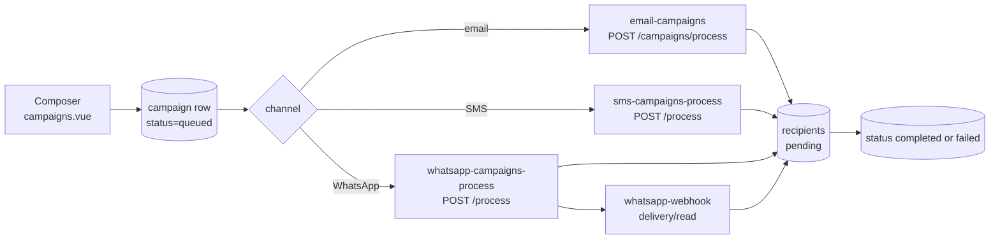

# Campaigns

A campaign is a stored message template plus a recipient list, processed in the background
by an edge function. You create it from `frontend/src/pages/campaigns.vue`; the record is
written to Postgres in `queued` state, a trigger or the create handler starts the matching
processor, and the processor sends one message per recipient and writes the final status
back. The same tables back both SMS and WhatsApp; `private.sms_campaigns.channel`
discriminates them (`supabase/migrations/20260531120000_add_whatsapp_channel.sql`).

| Channel  | Create / manage              | Processor                    | Provider                                                        |
| -------- | ---------------------------- | ---------------------------- | --------------------------------------------------------------- |
| Email    | `email-campaigns`            | `email-campaigns` `/process` | SMTP sender in `private.smtp_senders` or an OAuth mining source |
| SMS      | `sms-campaigns`, `sms-fleet` | `sms-campaigns-process`      | Twilio, SMSGate, simple-sms-gateway, or a fleet gateway         |
| WhatsApp | `whatsapp-campaigns`         | `whatsapp-campaigns-process` | OpenWA sessions (`private.whatsapp_sessions`)                   |

## The flow

Campaign rows are the queue. Email and SMS processors are invoked by `pg_cron` every ten
minutes; WhatsApp is invoked directly by its create/restart handler.

The email trigger is `private.trigger_email_campaign_processor()`; the SMS trigger is
`private.trigger_sms_campaign_processor()` (`supabase/migrations/20260304160000_standardize_edge_function_invocation.sql`,
`20260418010000_update_sms_cron_job_endpoint.sql`). Both post to the function with the
service-role key and run on `*/10 * * * *`. WhatsApp has no cron: `whatsapp-campaigns`
calls `whatsapp-campaigns-process` after create and restart.

## Per channel

### Email

Implemented by `supabase/functions/email-campaigns/` (`index.ts`, `email.ts`,
`middlewares-mod.ts`). Every email route lives here. It uses `private.email_campaigns`,
`email_campaign_recipients`, `email_campaign_links` and `email_campaign_events`, and sends
through nodemailer using an SMTP sender row or Gmail/Microsoft OAuth credentials from a
mining source (`email.ts`, `sender-options.ts`).

**What differs:** email is the only channel with an open-tracking pixel, and it rewrites
links for click tracking. Recipient eligibility excludes `opt_out` contacts and
`RISKY`/`INVALID` addresses; `only_valid_contacts` narrows it to `VALID` only (`index.ts`).

### SMS

Implemented by `supabase/functions/sms-campaigns/` (management, provider setup, preview,
quota) and `supabase/functions/sms-campaigns-process/` (delivery). Providers live in
`sms-campaigns/providers/` and `sms-campaigns-process/providers/`. The processor picks a
gateway, sends one message per pending recipient, and updates `sent_count` /
`failed_count` through `increment_sms_campaign_counts_atomic`
(`supabase/migrations/20260714000000_increment_sms_campaign_counts_atomic.sql`).

**What differs:** recipients are phones, not emails; a user must configure a provider or
fleet gateway first, and the processor checks `private.sms_campaign_unsubscribes` before
sending. Short links and unsubscribe links go through `campaigns-track`.

### WhatsApp

Implemented by `supabase/functions/whatsapp-campaigns/` (sessions, QR, create, preview,
stop/restart/delete) and `whatsapp-campaigns-process/`; acks and QR/disconnect events arrive
at `whatsapp-webhook/`. It reuses `private.sms_campaigns` and `sms_campaign_recipients`
with `channel = 'whatsapp'`, `provider = 'openwa'`, plus `private.whatsapp_sessions`.

**What differs:** there is no per-message HTTP provider. A connected OpenWA session is the
sender, and `whatsapp-webhook` updates `ack_status`, `delivered_at` and `read_at` on the
recipient row. The webhook verifies `x-webhook-signature` with `OPENWA_WEBHOOK_SECRET`.

## Tables

All in the `private` schema; RLS restricts rows to the owning user.

| Table                             | Holds                                                         |
| --------------------------------- | ------------------------------------------------------------- |
| `email_campaigns`                 | Email campaign config, counters, status, timestamps           |
| `email_campaign_recipients`       | One row per contact: send status, SMTP error, tokens          |
| `email_campaign_links`            | Rewritten URLs and their click short tokens                   |
| `email_campaign_events`           | `open`, `click`, `unsubscribe` events per recipient           |
| `sms_campaigns`                   | SMS **and** WhatsApp campaigns: `channel`, provider, counters |
| `sms_campaign_recipients`         | Phone, rendered message, status, provider id, ack fields      |
| `sms_campaign_link_clicks`        | Short link tokens for SMS/WhatsApp clicks                     |
| `sms_campaign_unsubscribes`       | Suppression list keyed by `(user_id, phone)`                  |
| `sms_campaign_recipient_gateways` | Which gateway was assigned to which recipient                 |
| `sms_fleet_gateways`              | User-owned SMS gateways, quota and health                     |
| `whatsapp_sessions`               | OpenWA session name, status, QR, assigned phone               |
| `smtp_senders`                    | Email sender credentials used by email campaigns              |

Consent lives on `private.persons.consent_status` / `consent_changed_at`, not on campaign rows
(`supabase/migrations/20260214190000_add_consent_status_and_unsubscribe.sql`).

## Tracking, consent and unsubscribe

Tokens are opaque random strings, not signed JWTs. `_shared/short-token.ts` generates
short base62 tokens (8 characters by default) stored in `email_campaign_recipients.open_short_token` /
`unsubscribe_short_token`, `email_campaign_links.short_token` and
`sms_campaign_recipients.unsubscribe_short_token` (`20260305001000_add_short_tokens_for_email_tracking.sql`,
`20260317000005_add_sms_short_tokens.sql`).

The frontend pages `/o/[token]`, `/c/[token]` and `/u/[token]` redirect to
`campaigns-track` (`frontend/src/pages/{o,c,u}/[token].vue`). `campaigns-track` resolves
the token in this order:

- **Click** — try `sms_campaign_link_clicks.token`, then `email_campaign_links.short_token`.
  SMS increments `sms_campaigns.click_count`; email inserts an `email_campaign_events`
  row before redirecting.
- **Open** — look up `email_campaign_recipients.open_short_token`, insert an `open` event,
  return a 1×1 GIF with `Cache-Control: no-store`. Email only.
- **Unsubscribe** — try SMS (`sms_campaign_recipients.unsubscribe_short_token`) then email.
  SMS upserts `sms_campaign_unsubscribes` and increments `unsubscribe_count`. Email sets
  `persons.consent_status = 'opt_out'`, marks that contact's pending recipients `skipped`,
  inserts an `unsubscribe` event, and redirects to `/unsubscribe/success`.

`email-campaigns` also exposes duplicate `/track/open/:token`, `/track/click/:token` and
`/unsubscribe/:token` routes. Both functions have `verify_jwt = false`; `email-campaigns`
guards its non-tracking routes with its own auth middleware.

Consent is enforced twice: at create/preview time in `email-campaigns/middlewares-mod.ts`
(blocks `opt_out`, warns when only part of the selection has consent), and again per
recipient in `index.ts`. Unsubscribe always writes to `private.persons`, so it survives
later campaigns.

## Status lifecycle

Email and SMS both use an enum named `<channel>_campaign_status` with the same values;
WhatsApp uses `sms_campaign_status` because it shares the SMS tables.

| Status       | Entered when                                                    |
| ------------ | --------------------------------------------------------------- |
| `queued`     | Create, or `POST /campaigns/:id/restart`                        |
| `processing` | Processor claims the row and sets `started_at`                  |
| `completed`  | Processor finishes; email also requires zero pending recipients |
| `failed`     | Processor error, or zero sent with at least one failure         |
| `cancelled`  | `POST /campaigns/:id/stop` while queued or processing           |

Recipient status is separate: `pending` → `sent` / `failed` / `skipped`; WhatsApp adds
`delivered` and `read` to the enum, though the webhook currently records those in
`ack_status` rather than `send_status`.

## How to exercise it locally

- **SMS**: `micro-services/sms-gateway-mock` listens on `8085` and simulates SMSGate and
  simple-sms-gateway (`GET /health`, `POST /config`, `POST /:provider/send-sms`). It is
  included in `docker-compose.dev.yml` and refuses to start with `NODE_ENV=production`.
  The edge runtime container cannot reach your host's `localhost`, so expose it with a
  tunnel (ngrok) and set the gateway `baseUrl` to the tunnel URL — see
  `micro-services/sms-gateway-mock/README.md`.
- **Email**: no mock exists. Point `SMTP_HOST`/`SMTP_PORT`/`SMTP_USER`/`SMTP_PASS` at a
  local SMTP sink, or configure a real SMTP sender through `/api/smtp-senders`. The
  processor is cron-driven, so `pg_cron` and `pg_net` must be enabled for a queued
  campaign to start.
- **WhatsApp**: no mock exists. You need a running OpenWA instance (`OPENWA_API_URL`,
  `OPENWA_API_KEY`) and a scanned QR code before a campaign can send.
- **End-to-end**: SMS is fully testable with the mock. Email is testable up to the SMTP
  boundary. WhatsApp delivery/read is not testable without OpenWA.

## Known gaps

- The list page reads the `get_campaigns_overview` / `get_sms_campaigns_overview` RPCs,
  not the edge-function list routes (`frontend/src/stores/campaigns.ts`).
- WhatsApp has no consent gate and its processor does not consult
  `sms_campaign_unsubscribes`; only SMS enforces the suppression list.
- The overview RPC reads `sms_campaigns.delivered_count` / `read_count`, but no function
  writes them; WhatsApp acks land on the recipient row instead.
- Tracking tokens are bearer secrets with no signature or single-use check.

## Related docs

- [API reference](api.md) — every campaign route with method and auth.
- [Architecture](architecture.md) — where edge functions sit in the request path.
- [Local development](local-development.md) — starting Supabase, Redis and the services.
