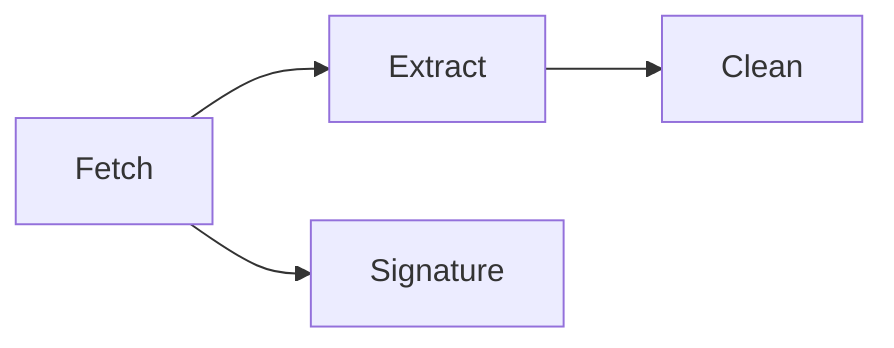

# Mining Pipeline

A mining run turns a mailbox, a file, or a PST archive into contacts. The work is split into stages that pass messages through Redis streams. Every stage is a `Task` inside one `Pipeline`, and a run has one `miningId` that ties its streams, task rows, and progress events together.

## The pipeline in one picture

`Clean` is optional and only runs when cleaning is enabled and an email verifier is configured. `Signature` is optional and only runs when body fetching and signature extraction are enabled. `Fetch` writes to both downstream stages: messages go to `Extract`, and email bodies go to `Signature`.

## Run shapes

The factories in `backend/src/services/tasks-manager-v2/factories.ts` assemble different task sets depending on the source.

| Source | Tasks                                                                                                                                       |
| ------ | ------------------------------------------------------------------------------------------------------------------------------------------- |
| IMAP   | `Fetch` → `Extract` → optional `Clean`; optional `Signature` in parallel. Add `GoogleContactsFetch` when Google Contacts sync is requested. |
| File   | `Extract` → optional `Clean`.                                                                                                               |
| PST    | `Fetch` → `Extract` → optional `Clean`; optional `Signature` in parallel.                                                                   |

`Clean` is skipped unless `cleaningEnabled` is true and `hasEmailVerificationConfigured(ENV)` passes. `Signature` is skipped unless `fetchEmailBody` is true and the run has mailboxes.

## Tasks, not jobs

`backend/src/services/tasks-manager-v2/` is the orchestration layer.

- `MiningEngine` owns the live pipelines. It subscribes to each run's `miningId` pub/sub channel and routes messages to the right `Pipeline` (`MiningEngine.ts`).
- `Pipeline` owns an ordered `Map<string, Task>`, creates the Redis consumer groups, tracks progress links between stages, and forwards progress to SSE (`Pipeline.ts`).
- `Task` is the base unit. It owns the task row in `private.tasks` and, when the task has streams, publishes `REGISTER` and `DELETE` commands to `REDIS_PUBSUB_COMMUNICATION_CHANNEL` (`tasks/Task.ts`).

The factory also wires progress links. For example, `CleanTask` inherits its total from the Extract task's `createdContacts` count, and `SignatureTask` runs without a total until the fetcher reports one (`factories.ts` lines 173–183).

## Task lifecycle

1. `Pipeline.start` calls `createConsumerGroups`, then `Task.start` for every task in order.
2. `Task.start` inserts a row into `private.tasks` and, when the task has streams, publishes a `REGISTER` command with its input and output streams.
3. The relevant worker receives `REGISTER`, adds the stream to its active set, and starts consuming.
4. Progress messages update the task's `progress.processed` and `progress.total`.
5. `Pipeline.checkCompletion` stops tasks whose `isComplete()` returns true and records the run through the `mining-completion` edge function.
6. When every task is stopped, `Pipeline.complete` deletes the consumer groups and streams and sends a final `mining-completed` or `mining-failed` SSE event.

## Each stage

### Fetch

- **What it does:** Connects to IMAP (or reads a PST) and streams messages into Redis.
- **Reads:** Mailbox folders and credentials from `private.mining_sources`.
- **Writes:** `messages_stream-<miningId>` and, when enabled, `REDIS_SIGNATURE_STREAM_NAME`. Also emits progress to the `miningId` pub/sub channel.
- **Runs in:** `micro-services/emails-fetcher`, started by `FetchTask.start` through `EmailFetcherClient` (`backend/src/services/email-fetching/index.ts`).
- **Stream:** `messages_stream-<miningId>` is built in `backend/src/services/tasks-manager-v2/factories.ts`. Fetch is a producer, so it has no consumer group.

### Extract

- **What it does:** Parses each message, extracts people, organizations, and tags, and upserts them into Postgres.
- **Reads:** `messages_stream-<miningId>`.
- **Writes:** `private.messages`, `private.persons`, `private.pointsofcontact` through `PgContacts` (`backend/src/db/pg/PgContacts.ts`). If cleaning is enabled, it also writes `emails_stream-<miningId>`.
- **Runs in:** `backend/src/messageWorker.ts` through `MessagesConsumer` (`backend/src/workers/email-message/MessagesConsumer.ts`).
- **Stream and group:** `messages_stream-<miningId>`, consumer group `REDIS_EXTRACTING_STREAM_CONSUMER_GROUP`, batch `REDIS_CONSUMER_BATCH_SIZE`.

### Clean (optional)

- **What it does:** Verifies email deliverability and stores the result on the contact.
- **Reads:** `emails_stream-<miningId>`.
- **Writes:** `private.email_status` and contact tags/reachability.
- **Runs in:** `backend/src/emailVerificationWorker.ts` through `EmailVerificationConsumer` (`backend/src/workers/email-verification/EmailsVerificationConsumer.ts`).
- **Stream and group:** `emails_stream-<miningId>`, consumer group `REDIS_CLEANING_STREAM_CONSUMER_GROUP`, batch `REDIS_EMAIL_VERIFICATION_CONSUMER_BATCH_SIZE`.
- **Gate:** `createImapMining` only adds this task when `cleaningEnabled` is true and `hasEmailVerificationConfigured(ENV)` is true (`factories.ts` lines 116–134).

### Signature (optional)

- **What it does:** Extracts signatures from message bodies and stores them per person.
- **Reads:** `REDIS_SIGNATURE_STREAM_NAME`.
- **Writes:** `private.signatures` through `upsertSignaturesDB` (`backend/src/workers/email-signature/utils.ts`).
- **Runs in:** `backend/src/emailSignatureWorker.ts` through `EmailSignatureConsumer` (`backend/src/workers/email-signature/consumer.ts`).
- **Stream and group:** `REDIS_SIGNATURE_STREAM_NAME`, consumer group `REDIS_SIGNATURE_STREAM_CONSUMER_GROUP`, batch `REDIS_EMAIL_SIGNATURE_CONSUMER_BATCH_SIZE`.
- **Gate:** `createImapMining` only adds this task when `fetchEmailBody` is true and the run has mailboxes (`factories.ts` lines 136–149).

## The Redis contract

These keys are defined in `backend/src/config/schema.ts`. Defaults below come from `.env.docker`.

| Purpose                   | Key or value                                           | Default                             |
| ------------------------- | ------------------------------------------------------ | ----------------------------------- |
| Messages stream           | `messages_stream-<miningId>` (built in `factories.ts`) | —                                   |
| Emails stream             | `emails_stream-<miningId>` (built in `factories.ts`)   | —                                   |
| Extraction consumer group | `REDIS_EXTRACTING_STREAM_CONSUMER_GROUP`               | `email-messages-consumer-group`     |
| Cleaning consumer group   | `REDIS_CLEANING_STREAM_CONSUMER_GROUP`                 | `email-verification-consumer-group` |
| Signature stream          | `REDIS_SIGNATURE_STREAM_NAME`                          | `email-signature-stream`            |
| Signature consumer group  | `REDIS_SIGNATURE_STREAM_CONSUMER_GROUP`                | `email-signature-consumer-group`    |
| Extraction batch size     | `REDIS_CONSUMER_BATCH_SIZE`                            | `200`                               |
| Verification batch size   | `REDIS_EMAIL_VERIFICATION_CONSUMER_BATCH_SIZE`         | `1000`                              |
| Signature batch size      | `REDIS_EMAIL_SIGNATURE_CONSUMER_BATCH_SIZE`            | `500`                               |
| Task command channel      | `REDIS_PUBSUB_COMMUNICATION_CHANNEL`                   | `stream-management`                 |

A consumer group lets several worker processes share one stream: each message goes to one consumer in the group, and the group tracks what has been read. The pipeline creates the extraction and cleaning groups at `$` (`Pipeline.createConsumerGroups`); the signature worker creates its own group at boot. A new run therefore only consumes messages published after its group exists.

Each worker boots the same way: subscribe to `REDIS_PUBSUB_COMMUNICATION_CHANNEL`, wait for `REGISTER` commands, then loop over the active streams with `xreadgroup` (`backend/src/workers/email-message/MessagesConsumer.ts`, `backend/src/workers/email-verification/EmailsVerificationConsumer.ts`, `backend/src/workers/email-signature/consumer.ts`).

## Progress and cancellation

Progress is pushed, not polled.

1. A worker publishes a JSON `ProgressMessage` to the run's `miningId` channel. For example, the extraction worker publishes `createdContacts` and `extracted` counts (`backend/src/workers/email-message/emailMessageHandlers.ts`).
2. `MiningEngine` receives the message and calls `Pipeline.onMessage`.
3. `Pipeline.onMessage` updates the relevant `Task` and emits an SSE event through its `RealtimeSSE` broadcaster (`Pipeline.ts` lines 77–86 and 145–162).
4. The browser opened `GET /api/imap/mine/:type/:id/progress/` when the run started. `frontend/src/utils/sse.ts` maps event names back to UI counters.

| Event suffix                                         | Emitted by                | Meaning                             |
| ---------------------------------------------------- | ------------------------- | ----------------------------------- |
| `totalMessages`                                      | `FetchTask`               | Messages the fetcher plans to read. |
| `fetched`                                            | `FetchTask`               | Messages read so far.               |
| `extracted`                                          | `ExtractTask`             | Messages parsed so far.             |
| `createdContacts`                                    | `ExtractTask`             | Contacts created so far.            |
| `verifiedContacts`                                   | `CleanTask`               | Addresses verified so far.          |
| `signatures` / `totalSignatures`                     | `SignatureTask`           | Signatures found and expected.      |
| `googleContactsFetchedCount` / `googleContactsTotal` | `GoogleContactsFetchTask` | Google Contacts progress.           |

To stop a run, the browser calls `POST /api/imap/mine/:type/:userId/:id` with `{ processes, endEntireTask }`. The controller calls `MiningEngine.terminate`, which calls `Pipeline.cancel`. Each stopped `Task` publishes a `DELETE` command on `REDIS_PUBSUB_COMMUNICATION_CHANNEL` so workers unregister the stream, and `FetchTask.stop` calls the fetcher's `DELETE /api/imap/fetch/stop` (`backend/src/services/tasks-manager-v2/tasks/FetchTask.ts`).

## Resuming and idempotency

A re-run is safe because the code is built for at-least-once delivery.

- **Message upserts:** Messages are inserted with `ON CONFLICT (message_id, user_id) DO NOTHING`, and people are upserted on `(user_id, source, email)` (`backend/src/db/pg/PgContacts.ts` lines 116–180). Re-processing the same message does not create a second row.
- **Watermarks:** The fetcher emits a per-folder `{ uidvalidity, last_uid }` cursor at the end of a run (`micro-services/emails-fetcher/src/services/imap/watermark.ts`). `FetchTask` stores it in the task's `details.watermark`, and the `mining-completion` edge function writes it to `mining_sources.config.mining.last` (`supabase/functions/mining-completion/index.ts`).
- **Incremental runs:** The API builds `resumeFrom` from the stored watermark and sends it to the fetcher (`backend/src/controllers/mining.controller.ts` lines 404–417). A UID-validity mismatch falls back to a full scan.
- **Read-once consumers:** `RedisMultipleStreamsConsumer` reads with `NOACK` and trims processed entries with `xtrim` (`backend/src/utils/streams/redis/RedisMultipleStreamsConsumer.ts`). The stream is a work queue, not a replay log.

## Where to look when it breaks

| Symptom                                          | Start here                                                                                                                                                         |
| ------------------------------------------------ | ------------------------------------------------------------------------------------------------------------------------------------------------------------------ |
| Task row stays `running` and no progress arrives | `backend/src/services/tasks-manager-v2/Pipeline.ts`, `backend/src/workers/email-message/MessagesConsumer.ts`                                                       |
| Browser shows no SSE events                      | `backend/src/controllers/stream.controller.ts`, `backend/src/services/factory/SSEBroadcasterFactory.ts`, `frontend/src/utils/sse.ts`                               |
| Stream has entries but no worker consumes them   | `backend/src/messageWorker.ts`, `backend/src/utils/streams/redis/RedisMultipleStreamsConsumer.ts`, the `REDIS_*` keys in `backend/src/config/schema.ts`            |
| Fetch never starts                               | `backend/src/services/email-fetching/index.ts`, `micro-services/emails-fetcher/src/api.ts`, `micro-services/emails-fetcher/src/services/imap/ImapEmailsFetcher.ts` |
| Duplicate contacts after a rerun                 | `backend/src/db/pg/PgContacts.ts`, `micro-services/emails-fetcher/src/services/imap/watermark.ts`, `supabase/functions/mining-completion/index.ts`                 |
| Cleaning or signatures never run                 | `backend/src/services/tasks-manager-v2/factories.ts` (the optional gates)                                                                                          |
