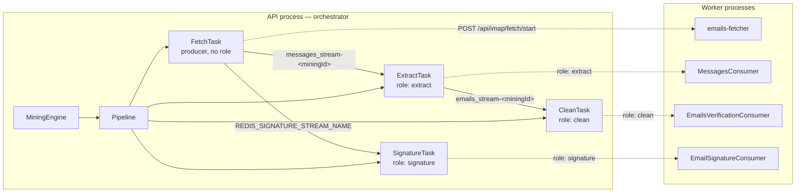

# Mining Pipeline

A mining run turns a mailbox, a file, or a PST archive into contacts. The work is split into stages that pass messages through Redis streams. Every stage is a `Task` inside one `Pipeline`, and a run has one `miningId` that ties its streams, task rows, and progress events together.

## The task graph and its streams

**The task graph.** Tasks are orchestration objects in the API process; consumers are separate worker processes, and every edge between them crosses Redis.

What to take from it: solid edges are Redis streams; dotted edges are the role filter published by `Task.start` (`Task.ts:106`); boxes are process boundaries, and `FetchTask` is the only task without a role because it drives the fetcher over HTTP.

## Which tasks run for which source

| Source | Tasks                                                                                                                                       |
| ------ | ------------------------------------------------------------------------------------------------------------------------------------------- |
| IMAP   | `Fetch` → `Extract` → optional `Clean`; optional `Signature` in parallel. Add `GoogleContactsFetch` when Google Contacts sync is requested. |
| File   | `Extract` → optional `Clean`.                                                                                                               |
| PST    | `Fetch` → `Extract` → optional `Clean`; optional `Signature` in parallel.                                                                   |

## Task lifecycle

1. `Pipeline.start` calls `createConsumerGroups`, then `Task.start` for every task in order.
2. `Task.start` inserts a row into `private.tasks` and, when the task has streams, publishes a `REGISTER` command with its input and output streams.
3. The extract and clean workers receive `REGISTER` and add the stream to their active sets; the signature worker always consumes its shared stream and only logs the command.
4. Progress messages update the task's `progress.processed` and `progress.total`.
5. `Pipeline.checkCompletion` stops tasks whose `isComplete()` returns true and records the run through the `mining-completion` edge function.
6. When every task is stopped, `Pipeline.complete` deletes the consumer groups and streams and sends a final `mining-completed` or `mining-failed` SSE event.

## Each stage

**Stages and their streams.** Fetch produces; the other stages consume one stream each, write Postgres, and run in a different process. The gate column explains why a stage may be absent from a run.

| Stage         | Does                                               | Reads                         | Writes                                                                                                      | Runs in                                                                                   | Gate                                                        |
| ------------- | -------------------------------------------------- | ----------------------------- | ----------------------------------------------------------------------------------------------------------- | ----------------------------------------------------------------------------------------- | ----------------------------------------------------------- |
| **Fetch**     | Connects to IMAP or reads a PST                    | `private.mining_sources`      | `messages_stream-<miningId>`, `REDIS_SIGNATURE_STREAM_NAME`; progress on `miningId`                         | `micro-services/emails-fetcher`, started by `FetchTask.start` (`email-fetching/index.ts`) | Always, for IMAP and PST                                    |
| **Extract**   | Parses messages, extracts people and organizations | `messages_stream-<miningId>`  | `private.messages`, `persons`, `pointsofcontact` via `PgContacts`; `emails_stream-<miningId>` when cleaning | `backend/src/messageWorker.ts` (`MessagesConsumer`)                                       | Always                                                      |
| **Clean**     | Verifies deliverability and tags the contact       | `emails_stream-<miningId>`    | `private.email_status`                                                                                      | `backend/src/emailVerificationWorker.ts` (`EmailsVerificationConsumer`)                   | `cleaningEnabled` and `hasEmailVerificationConfigured(ENV)` |
| **Signature** | Extracts signatures from message bodies            | `REDIS_SIGNATURE_STREAM_NAME` | `private.signatures` via `upsertSignaturesDB`                                                               | `backend/src/emailSignatureWorker.ts` (`EmailSignatureConsumer`)                          | `fetchEmailBody` and the run has mailboxes                  |

## The Redis contract

Streams carry work; pub/sub carries progress and task commands. These keys are defined in `backend/src/config/schema.ts` under `/* REDIS */`. Defaults below come from `.env.docker`.

| Purpose                   | Key or value                                           | Default                             |
| ------------------------- | ------------------------------------------------------ | ----------------------------------- |
| Messages stream           | `messages_stream-<miningId>` (built in `factories.ts`) | —                                   |
| Emails stream             | `emails_stream-<miningId>` (built in `factories.ts`)   | —                                   |
| Extraction consumer group | `REDIS_EXTRACTING_STREAM_CONSUMER_GROUP`               | `email-messages-consumer-group`     |
| Cleaning consumer group   | `REDIS_CLEANING_STREAM_CONSUMER_GROUP`                 | `email-verification-consumer-group` |
| Signature stream          | `REDIS_SIGNATURE_STREAM_NAME`                          | `email-signature-stream`            |
| Signature consumer group  | `REDIS_SIGNATURE_STREAM_CONSUMER_GROUP`                | `email-signature-consumer-group`    |
| Extraction batch size     | `REDIS_CONSUMER_BATCH_SIZE`                            | `200`                               |
| Verification batch size   | `REDIS_EMAIL_VERIFICATION_CONSUMER_BATCH_SIZE`         | `1000`                              |
| Signature batch size      | `REDIS_EMAIL_SIGNATURE_CONSUMER_BATCH_SIZE`            | `500`                               |
| Task command channel      | `REDIS_PUBSUB_COMMUNICATION_CHANNEL`                   | `stream-management`                 |

A consumer group lets several worker processes share one stream: each message goes to one consumer in the group, and the group tracks what has been read. The pipeline creates the extraction and cleaning groups at `$` (`Pipeline.createConsumerGroups`); the signature worker creates its own group at boot. A new run therefore only consumes messages published after its group exists.

Each worker boots the same way: subscribe to `REDIS_PUBSUB_COMMUNICATION_CHANNEL`, wait for `REGISTER` commands, then loop over the active streams with `xreadgroup` (`backend/src/workers/email-message/MessagesConsumer.ts`, `backend/src/workers/email-verification/EmailsVerificationConsumer.ts`, `backend/src/workers/email-signature/consumer.ts`).

## Watch progress

Progress is pushed, not polled. A worker publishes a JSON `ProgressMessage` to the run's `miningId` channel — for example `createdContacts` from the extraction handler (`backend/src/workers/email-message/emailMessageHandlers.ts:112`). `MiningEngine`, subscribed in `submit`, hands it to `Pipeline.onMessage` (`MiningEngine.ts:47`, `Pipeline.ts:145`).

**Progress fan-out.** One worker message updates every task, then becomes one SSE event for the browser.

```mermaid
sequenceDiagram
  MC->>R: PUBLISH miningId<br/>ProgressMessage {progressType: "createdContacts", count: 42}
  R-->>ME: message on the miningId channel
  ME->>P: onMessage(json)
  P->>ET: onMessage(msg)
  Note over P,CT: onMessage runs on every task
  ET->>ET: addCreatedContacts(42)
  P->>P: propagateProgress()
  Note over P,CT: ExtractTask.isComplete()<br/>CleanTask.upstreamDone = true<br/>CleanTask.progress.total = getProgressMap()["createdContacts"] = 42
  P->>CT: progress.total = 42
  P->>SSE: sendSSE(42, "createdContacts-&#60;miningId&#62;")
  SSE-->>Br: SSE event on GET /api/imap/mine/:type/:id/progress/
  P->>P: checkCompletion()
```

What to take from it: the browser sees a counter only after `propagateProgress` has copied or summed totals across the task graph.

`Pipeline.onMessage` calls `task.onMessage` on every task, then `propagateProgress`, then `checkCompletion` (`Pipeline.ts:158`, `:164`, `:194`). `propagateProgress` fires when every upstream task reports `isComplete()`; it copies `totalFrom` from the upstream progress map, or sums upstream `processed` when no `totalFrom` is set, unless the link has `skipTotal` (`Pipeline.ts:173`). `CleanTask` uses `totalFrom: 'createdContacts'` (`factories.ts:175`), and `SignatureTask` uses `skipTotal` (`factories.ts:181`). Events reach the browser through `RealtimeSSE`; `frontend/src/utils/sse.ts` maps event names back to UI counters.

| Event suffix                                         | Emitted by                | Meaning                             |
| ---------------------------------------------------- | ------------------------- | ----------------------------------- |
| `totalMessages`                                      | `FetchTask`               | Messages the fetcher plans to read. |
| `fetched`                                            | `FetchTask`               | Messages read so far.               |
| `extracted`                                          | `ExtractTask`             | Messages parsed so far.             |
| `createdContacts`                                    | `ExtractTask`             | Contacts created so far.            |
| `verifiedContacts`                                   | `CleanTask`               | Addresses verified so far.          |
| `signatures` / `totalSignatures`                     | `SignatureTask`           | Signatures found and expected.      |
| `googleContactsFetchedCount` / `googleContactsTotal` | `GoogleContactsFetchTask` | Google Contacts progress.           |

## Stop a run

The browser calls `POST /api/imap/mine/:type/:userId/:id` with `{ processes, endEntireTask }`. The controller calls `MiningEngine.terminate`, which calls `Pipeline.cancel`. Three things then happen:

1. Each stopped `Task` publishes a `DELETE` command on `REDIS_PUBSUB_COMMUNICATION_CHANNEL`, so workers unregister the stream.
2. `FetchTask.stop` calls the fetcher's `DELETE /api/imap/fetch/stop` (`backend/src/services/tasks-manager-v2/tasks/FetchTask.ts`).

The run then completes as described in [Task lifecycle](#task-lifecycle).

## Resuming and idempotency

- **Message upserts:** Messages are inserted with `ON CONFLICT (message_id, user_id) DO NOTHING`, and people are upserted on `(user_id, source, email)` (`backend/src/db/pg/PgContacts.ts:118`, `:128`). Re-processing the same message does not create a second row.
- **Watermarks:** The fetcher emits a per-folder `{ uidvalidity, last_uid }` cursor at the end of a run (`micro-services/emails-fetcher/src/services/imap/watermark.ts`). `FetchTask` stores it in the task's `details.watermark`, and the `mining-completion` edge function writes it to `mining_sources.config.mining.last` (`supabase/functions/mining-completion/index.ts`).
- **Incremental runs:** The API builds `resumeFrom` from the stored watermark and sends it to the fetcher (`backend/src/controllers/mining.controller.ts:407`). A UID-validity mismatch falls back to a full scan.
- **Read-once consumers:** `RedisMultipleStreamsConsumer` reads with `NOACK` and trims processed entries with `xtrim` (`backend/src/utils/streams/redis/RedisMultipleStreamsConsumer.ts`). The stream is a work queue, not a replay log.

## Where to look when it breaks

| Symptom                                          | Start here                                                                                                                                                         |
| ------------------------------------------------ | ------------------------------------------------------------------------------------------------------------------------------------------------------------------ |
| Task row stays `running` and no progress arrives | `backend/src/services/tasks-manager-v2/Pipeline.ts`, `backend/src/workers/email-message/MessagesConsumer.ts`                                                       |
| Browser shows no SSE events                      | `backend/src/controllers/stream.controller.ts`, `backend/src/services/factory/SSEBroadcasterFactory.ts`, `frontend/src/utils/sse.ts`                               |
| Stream has entries but no worker consumes them   | `backend/src/messageWorker.ts`, `backend/src/utils/streams/redis/RedisMultipleStreamsConsumer.ts`, the `REDIS_*` keys in `backend/src/config/schema.ts`            |
| Fetch never starts                               | `backend/src/services/email-fetching/index.ts`, `micro-services/emails-fetcher/src/api.ts`, `micro-services/emails-fetcher/src/services/imap/ImapEmailsFetcher.ts` |
| Duplicate contacts after a rerun                 | `backend/src/db/pg/PgContacts.ts`, `micro-services/emails-fetcher/src/services/imap/watermark.ts`, `supabase/functions/mining-completion/index.ts`                 |
| Cleaning or signatures never run                 | `backend/src/services/tasks-manager-v2/factories.ts` (the optional gates)                                                                                          |

## See also

[architecture.md](architecture.md), [api.md](api.md), [local-development.md](local-development.md).
